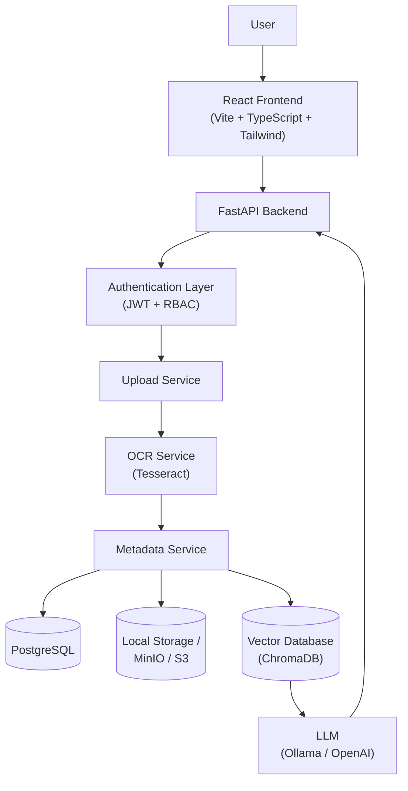
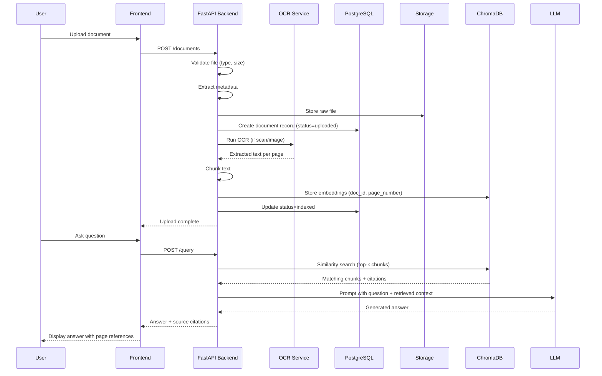
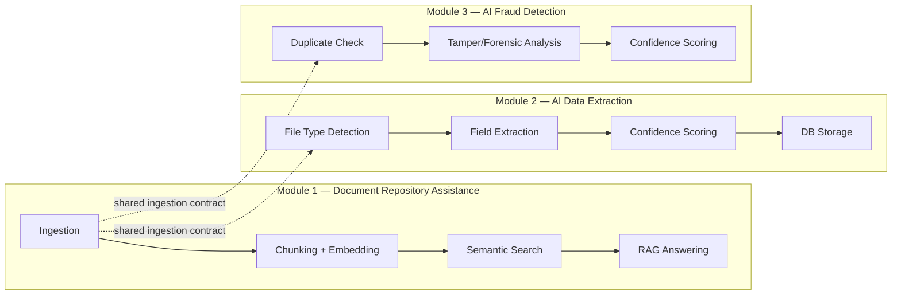

# DocSentinel — System Architecture

## System Overview

DocSentinel is a three-module, AI-powered Document Management System built around a **Retrieval-Augmented Generation (RAG) core**, an **AI extraction pipeline**, and a **fraud-detection engine**. The system is layered so that each concern — presentation, orchestration, AI processing, and persistence — can scale, fail, and be replaced independently.

### Layer responsibilities

| Layer | Responsibility | Key tech |
|---|---|---|
| Presentation | Renders UI, manages client state, calls backend REST API | React, Vite, TypeScript, Tailwind |
| API / Orchestration | Routes requests, enforces auth, coordinates services | FastAPI |
| Authentication | Issues/validates JWTs, enforces role-based access | JWT, Passlib |
| Upload Service | Receives files, validates type/size, hands off to storage + OCR | FastAPI route + service class |
| OCR Service | Converts scanned/image documents into machine-readable text | Tesseract |
| Metadata Service | Normalizes parsed output into the ingestion contract shape, writes DB rows | Python service layer |
| Relational Store | Source of truth for users, roles, documents, metadata, logs | PostgreSQL |
| Object Store | Stores raw uploaded files | Local disk (dev) → MinIO/S3 (prod) |
| Vector Store | Stores chunk embeddings for semantic search | ChromaDB |
| LLM Layer | Generates grounded answers from retrieved chunks | Ollama (dev), OpenAI (optional prod) |

### Why this architecture scales

- **Stateless API layer** — FastAPI instances hold no session state, so horizontal scaling is just adding more containers behind a load balancer.
- **Separation of relational vs vector storage** — exact structured lookups (permissions, status) stay in Postgres; "find semantically similar" queries stay in Chroma. Neither system is forced to do the other's job.
- **Swappable object storage** — the storage service is coded behind an interface, so moving from local disk to MinIO/S3 requires no changes to upload or OCR logic.
- **Swappable LLM/embedding backends** — Ollama for free local development, OpenAI as a drop-in production upgrade, without touching RAG orchestration code.
- **Decoupled OCR** — OCR is CPU-heavy and can be moved to a background worker/queue (e.g. Celery + Redis) later without changing the API contract.

## Request Lifecycle: Upload → Answer

### Why RAG instead of a plain LLM call

A raw LLM call has no knowledge of an organization's private documents and can hallucinate facts. RAG grounds every answer in retrieved chunks from the vector database, and because each chunk carries its `document_id` + `page_number`, the answer can cite exactly where it came from — this is what makes Module 1 auditable rather than a black box.

## Current Search and RAG Implementation

Search routes require an authenticated user. Before querying, the API builds the user's readable document scope from the existing role, department, assignment, and configured folder permissions. That scope constrains both SQL keyword results and Chroma vector retrieval; vector metadata is checked against database documents before results become citations. Search currently fuses keyword and vector rankings with reciprocal rank fusion. This is a ranking heuristic, not a calibrated relevance probability.

OCR text is chunked on paragraph and sentence boundaries where possible, with page numbers retained in vector metadata. Upload processing schedules indexing in a background thread, and startup backfills documents that have OCR rows but no embedding index. Stable document/page/chunk IDs make repeated indexing idempotent; new vectors are upserted before stale vectors are removed.

`POST /api/search/ask` retrieves scoped evidence and constructs citation objects from database records and retrieved excerpts. An OpenAI-compatible chat-completions endpoint can optionally generate an evidence-only answer when `RAG_LLM_BASE_URL`, `RAG_LLM_MODEL`, and `RAG_LLM_API_KEY` are configured. Without that configuration, the endpoint returns a retrieved-only status and the UI presents source passages instead of implying that a generated answer exists. Citation links open the document's OCR panel and scroll to the cited page when one is available.

The endpoint validates citation marker IDs and the backend controls the linked document/page, but it does not independently verify that every generated claim is entailed by its cited excerpt. No curated multilingual relevance benchmark or production LLM integration has been run yet. Use `backend/scripts/search_benchmark.py` with manually judged JSONL queries to measure ranking and abstention behavior before making accuracy claims. The current multilingual embedding model's performance on the project's target languages must be established with that evaluation.

## Module Boundaries

All three modules consume the same normalized ingestion output (see `ingestion-contract.md`), so adding Module 3 later required no changes to how Module 1 or 2 ingest files.
