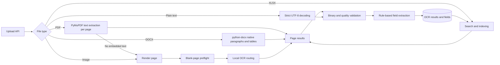

# OCR pipeline

## Current data flow



The existing upload route remains synchronous. PDFs are checked for embedded text page by page; pages with text are not sent through image OCR. Image OCR currently routes English to RapidOCR first and other supported selections to the installed PaddleOCR Devanagari path, with configured local fallbacks. Tesseract is an optional local fallback. Surya and Azure Document Intelligence are not integrated, and the current PaddleOCR dependency is 2.9.1; upgrading to PP-OCRv5 is not implied by the model support listed in newer PaddleOCR documentation.

DOCX and XLSX packages are identified by ZIP members and parsed natively with `python-docx` and `openpyxl`. DOCX tables retain header/value relationships as labeled rows, and worksheet names and cell coordinates are included for spreadsheets. Embedded DOCX/XLSX images use the existing image OCR path. PDF and image input is selected only after signature/parser checks. Plain text files require strict UTF-8 decoding; unknown and legacy `.doc`/`.xls` formats fail with an explicit processing status instead of being decoded as text. The DOCX parser does not infer Word's rendered page breaks, so its extracted content is currently stored as a single logical page.

After extraction, page text is checked for Office package markers, invalid controls, excessive replacement characters, short output and symbol-heavy output. Severe binary/encoding signals remove that page's text before persistence. A document with no usable text is marked `failed`, receives a review reason, and is neither indexed nor returned as a successful extraction. Warning-bearing pages remain available for review. The uploader or an administrator can retry through `POST /api/documents/{document_id}/reprocess`; a failed retry preserves prior OCR and fields. A successful retry replaces them and schedules a fresh index.

## Language and confidence behavior

The configured language choices are `auto`, `en`, `hi`, `mr`, `en+hi`, and `en+mr`. PaddleOCR's current PP-OCRv5 multilingual documentation lists Hindi, Marathi, and English for its Devanagari recognizer; this repository pins the older 2.9.1 package and uses its `devanagari` language configuration, so measured support and accuracy for that installed version still require a labeled benchmark. Tesseract upstream publishes separate `eng`, `hin`, and `mar` trained data. Tesseract now skips an explicit request if required data is absent instead of silently substituting another script. Auto mode uses only installed language data.

Provider confidence values are engine-specific scores and are not comparable or calibrated probabilities. They are retained on page OCR records only when the provider supplies a positive score, with the provider name recorded per page. Mixed-provider document-level confidence is left unset. Regex extraction still returns candidate values, but uncalibrated legacy field and document scores are no longer persisted; those values remain null and require human verification. OCR quality flags are warnings, not corrections or confidence scores. Original recognized text is retained.

Handwriting is not a verified capability of the configured local providers. Handwritten or annotation-heavy pages need human review. Tables and reading order are not currently represented structurally in persisted results; they remain known limitations.

## Labeled benchmark

Create UTF-8 JSONL with one manually verified sample per line:

```json
{"id":"invoice-001-p1","path":"samples/invoice-001.png","reference":"Invoice No: 1234","language":"en","category":"financial"}
```

Relative paths resolve from the manifest's directory. Run from `backend`:

```powershell
python scripts/ocr_benchmark.py --manifest path\to\ground-truth.jsonl --output report.json
```

The report includes per-language and per-category CER, WER, latency, provider and sample results. Normalization applies Unicode NFC and collapses whitespace only; it does not remove case, punctuation, digits, or script distinctions. The repository currently contains no verified labeled benchmark set, so no accuracy result or improvement is claimed. Ensure samples are lawfully usable and do not include sensitive documents unless approved for local processing.

For the existing single-PDF smoke run:

```powershell
$env:OCR_BENCHMARK_PDF = "C:\path\to\sample.pdf"
python scripts/ocr_benchmark.py
```

## Setup and limitations

Install `backend/requirements.txt`, install Tesseract 5.x separately if desired, and install the English/Hindi/Marathi trained data actually needed on the host. Set `OCR_TESSDATA_PATH` when it is outside Tesseract's default data directory. Paddle models may be downloaded lazily by PaddleOCR. Cloud credentials are not required.

No database migration is required for this increment. Existing `document_pages`, `ocr_results`, and `extracted_fields` schemas and API response contracts remain unchanged. Warning categories are recorded in the review-queue reason and structured logs. Retry traces, bounding boxes, rendered DOCX pagination, persisted table structure, and model version are not stored. Upload remains synchronous, so large multi-page files can occupy request workers. These items require further incremental work before the full production definition of done is met.
